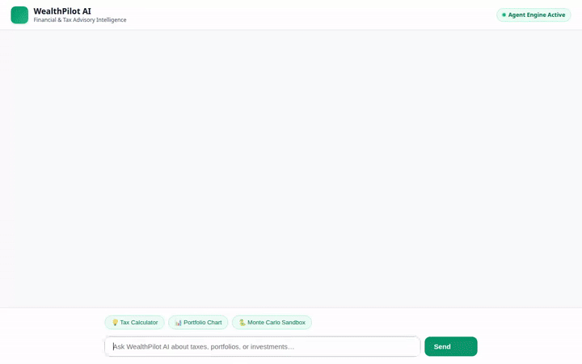

# WealthPilot AI 📈💡

**WealthPilot AI** is an intelligent, multimodal AI Financial, Tax, and Investment Advisor built on the **Google Agent Development Kit (ADK)** and deployed on **Google Cloud Agent Platform (Agent Engine)** using the **A2A Protocol**.

WealthPilot AI delivers personalized financial planning, dual-regime tax optimization, asset allocation charting, real-time currency conversion, generative visual product cards, and AI video explainers.



---

## 🌟 Key Features & Implemented Capabilities

WealthPilot AI is powered by `gemini-2.5-flash` with a rich suite of integrated Google Cloud services and custom tools:

### 🧠 Cross-Session Memory (Vertex AI Memory Bank)
* **Persistent Memory**: Uses `VertexAiMemoryBankService` with `PreloadMemoryTool` and an `after_agent_callback` memory generation pipeline.
* **Context Preservation**: Automatically remembers financial goals, risk tolerance, tax preferences, and personal details across conversations.

### 📊 Tax Optimization & Portfolio Visualizations
* **Tax Liability Calculator (`calculate_tax_liability`)**: Compares Old vs. New Tax Regimes (80C, 80D, HRA, Standard Deduction) and recommends optimal tax-saving strategies.
* **Portfolio Chart Generator (`generate_portfolio_chart`)**: Generates custom asset allocation pie charts using Matplotlib, saved directly as ADK artifacts and uploaded to Google Cloud Storage.
* **Market Rates & Financial News (`fetch_market_rates_and_news`)**: Fetches current benchmark interest rates (FD, PPF, Gold, Equity) and regulatory tax limits.

### 🎨 Multimodal Generative AI (Images & Video)
* **Image Generation (`generate_financial_product_image`)**: Uses `gemini-3.1-flash-lite-image` (in the `global` region) to generate visual assets for financial products and investment milestones.
* **Video Generation (`generate_financial_explainer_video`)**: Uses Google's Omni model (`gemini-omni-flash-preview` in the `global` region via the REST Interactions API) to produce animated financial explainer videos.
* **Dual Asset Persistence**: Both image and video tools save output locally as ADK artifacts (`tool_context.save_artifact`) and upload raw bytes to a public Google Cloud Storage bucket.

### 🗄️ Database & Cloud Services
* **Google Cloud Firestore (`get_financial_products`, `add_financial_product`)**: Stores and queries curated investment options, fixed deposits, and mutual funds.
* **Google Cloud Storage (GCS)**: Hosts generated images, charts, and explainer videos with public HTTPS URLs.
* **Agent Engine Sandbox (`google_python_interpreter`, `python_interpreter`)**: Executes Python code safely in isolated sandbox environments via `AgentEngineSandboxCodeExecutor`.
* **Real-time FX Rates (`get_currency_exchange_rates`)**: Retrieves live foreign exchange conversion rates for international financial planning.

### 🖥️ Rich User Interface & A2UI Protocol
* **A2UI v0.8 Protocol**: Emits structured A2UI card schemas (`A2uiSchemaManager`) rendered natively in ADK Web and custom frontends.
* **FastAPI A2A Proxy Frontend**: Lightweight Python FastAPI proxy server in `./frontend` connecting browser clients over the A2A protocol to deployed Agent Platform reasoning engines.

---

## 🏗️ Project Architecture

```
wealthpilot-ai/
├── app/                        # Core ADK Agent Implementation
│   ├── agent.py                # Main agent logic, tools, Memory Bank, and A2UI prompt
│   ├── a2ui_utils.py           # A2UI callback transformer for rich card rendering
│   └── app_utils/              # Helper utilities
├── frontend/                   # Custom FastAPI A2A Frontend
│   ├── main.py                 # FastAPI proxy server (A2A ClientFactory integration)
│   ├── static/
│   │   └── index.html          # Custom emerald theme UI with A2UI card renderer
│   └── pyproject.toml          # Frontend dependencies
├── tests/                      # Unit test suite
│   └── unit/                   # Tests for tax calculator, GCS/Firestore, & tools
├── agents-cli-manifest.yaml    # Agents CLI deployment manifest (us-central1)
├── deployment_metadata.json    # Agent Engine Reasoning Engine resource deployment metadata
├── pyproject.toml              # Agent dependencies & uv workspace config
└── GEMINI.md                   # AI Developer Guidance
```

---

## 🛠️ Prerequisites

* **Python 3.11+**
* **uv**: Python package manager (`pip install uv` or via [Astral uv](https://docs.astral.sh/uv/))
* **Google Cloud SDK (`gcloud`)**: Authenticated with your GCP project
* **google-agents-cli**: Installed via `uv tool install google-agents-cli`

---

## 🚀 Local Setup & Quick Start

### 1. Install Dependencies

Install project dependencies using `agents-cli`:

```bash
agents-cli install
```

### 2. Run the Agent in Development Playground

Launch the local ADK dev UI to test tools, Memory Bank persistence, and A2UI cards:

```bash
agents-cli playground
```

### 3. Run the Custom FastAPI Frontend Locally

To run the custom branded chat UI locally:

```bash
cd frontend
uv sync

# Set deployment resource name and agent directory
export AGENT_ENGINE_RESOURCE_NAME="projects/<PROJECT_ID>/locations/us-central1/reasoningEngines/<REASONING_ENGINE_ID>"
export AGENT_DIRECTORY="app"
export PORT=8081

uv run python main.py
```

Navigate to `http://localhost:8081` in your browser.

---

## 🧪 Running Unit Tests

Run the full test suite using `pytest`:

```bash
uv run pytest tests/unit
```

---

## ☁️ Cloud Deployment

### Deploy Agent to Agent Platform (Agent Engine)

```bash
gcloud config set project <YOUR_GCP_PROJECT_ID>
agents-cli deploy --no-confirm-project
```

### Deploy Frontend to Cloud Run

```bash
cd frontend
gcloud run deploy wealthpilot-ai-frontend \
  --source . \
  --region us-central1 \
  --set-env-vars AGENT_ENGINE_RESOURCE_NAME="projects/<PROJECT_ID>/locations/us-central1/reasoningEngines/<REASONING_ENGINE_ID>",AGENT_DIRECTORY="app" \
  --allow-unauthenticated
```
